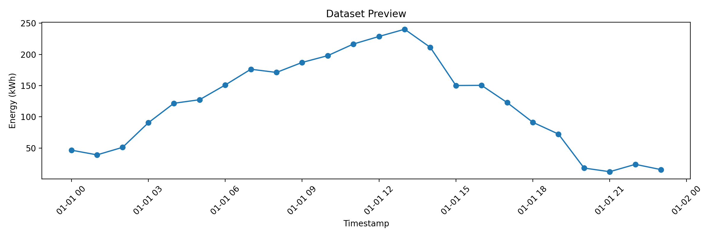
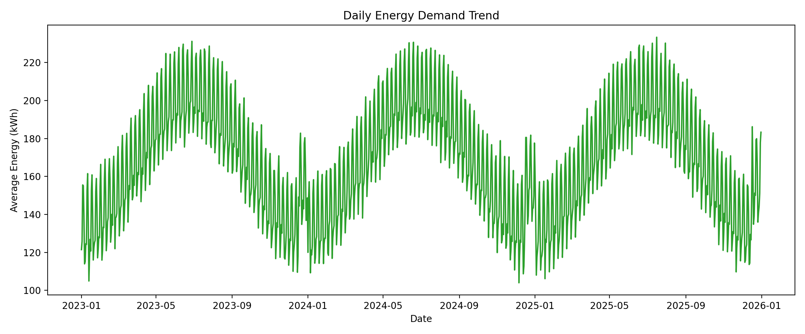
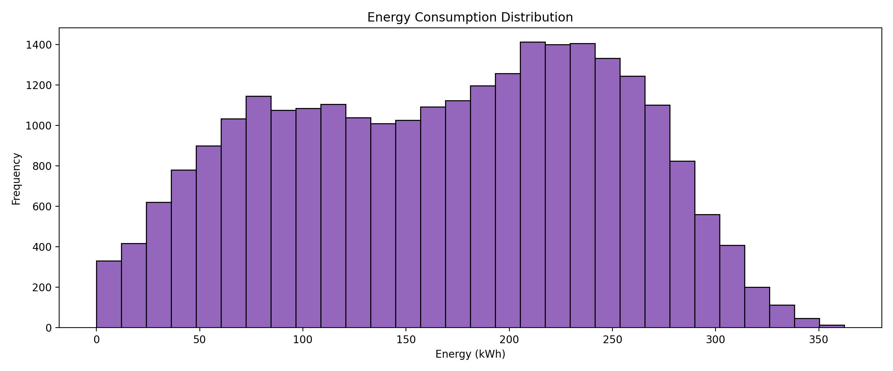

# AI-Powered Energy Consumption Forecasting

## Project Summary

This project builds an AI-driven energy forecasting system to estimate future electricity demand using time-series data, operational features, and machine learning techniques. It is designed to simulate a realistic smart-grid, building energy management, or industrial demand-planning system.

The goal is to help organizations predict consumption patterns, reduce peak-time costs, and support sustainable decision-making in energy-intensive environments.

## Problem Being Solved

Energy demand is uncertain and changes across time, occupancy, climate, and operational cycles. Without forecasting, facilities and cities face:

- inefficient energy usage
- higher electricity bills
- load imbalance between supply and demand
- poor planning for renewable energy integration
- risk of shortages or overloads during peak hours

## Business Value

The forecasting system supports:

- better energy planning for utility providers
- cost reduction for industrial and commercial users
- optimization of smart building systems
- support for renewable energy balancing
- sustainability and carbon-aware operations

## Project Highlights

- Synthetic hourly smart-grid dataset generation
- Data cleaning and preprocessing
- Time-based and lag-based feature engineering
- Random Forest forecasting model for demand prediction
- SARIMA seasonal forecasting alternative
- Flask `/predict` API backed by a separately trained hour/weekday MLP baseline
- Streamlit dashboard for interactive exploration
- Summary metrics: MAE, RMSE, and R²
- Portfolio-ready visuals and documentation

## Validation Results

The current forecasting pipeline produces strong results on the synthetic dataset:

- MAE: 9.50
- RMSE: 12.12
- R² Score: 0.9775

This demonstrates the model can learn patterns with strong predictive quality for a beginner-friendly project.

## Architecture Overview

```text
Energy data source
      |
      v
Data cleaning and preprocessing
      |
      v
Feature engineering (time, lag, rolling stats)
      |
      v
Model training and evaluation
      |
      v
Forecast generation and visualization
      |
      v
Business insight and planning support
```

## Screenshot Gallery







## Demo Dashboard

The project includes an interactive dashboard built with Streamlit:

- view forecast metrics
- compare model output and prediction trends
- select forecast horizon and time windows
- inspect actual vs predicted demand charts

Run:

```bash
streamlit run streamlit_app.py
```

## Prediction API

Train the API's small MLP baseline and start the local Flask service:

```bash
python train_api_model.py
python api.py
```

It accepts `hour` (0–23) and `day` (0–6, Monday–Sunday) at `POST /predict`. The API model is intentionally separate from the Random Forest model and uses fewer inputs, so treat it as a demonstration endpoint rather than the project's most informative forecasting model.

Interview Q&A and limitations are documented in [docs/interview_qa.md](docs/interview_qa.md).

## Folder Structure

```text
AI-Energy-Forecasting/
├── data/
├── docs/
├── images/
├── notebooks/
├── outputs/
├── scripts/
├── src/
├── api.py
├── train_api_model.py
├── README.md
├── PORTFOLIO.md
├── main.py
├── streamlit_app.py
├── requirements.txt
└── .gitignore
```

## Tech Stack

- Python
- Pandas
- NumPy
- Matplotlib
- Scikit-learn
- Statsmodels
- Streamlit
- Flask

## How to Run

```bash
python -m venv .venv
source .venv/bin/activate   # Mac/Linux
# or .venv\Scripts\activate on Windows
pip install -r requirements.txt
python main.py
streamlit run streamlit_app.py
```

## GitHub Proof Strategy

For a job or internship portfolio, this project is strong because it demonstrates:

1. Industry-aligned problem framing
2. Realistic data-engineering workflow
3. Practical machine learning model building
4. Business-oriented evaluation metrics
5. Clear project documentation and visuals

## Future Scope

Possible next improvements include:

- LSTM/GRU deep learning forecasting
- weather-aware demand models
- real-world utility datasets
- deployment-ready API service
- dashboard with live filters and alerting

## Final Statement

This project positions the student as someone who understands both AI and practical energy analytics. It is a strong portfolio piece for smart-city, climate-tech, and industrial optimization roles.
