# ⚡ AI-Powered Energy Consumption Forecasting

> An end-to-end Python project for exploring and forecasting hourly electricity demand with synthetic smart-grid data, Random Forest and SARIMA models, an interactive Streamlit dashboard, and a Flask prediction API.

---

## 👨‍💻 Author

**Adarsh Srivastav**<br>
Computer Science and Engineering (CSE) Student<br>
Machine Learning | Python | Energy Analytics

---

## 📌 Project Overview

This project demonstrates an energy-demand forecasting workflow for homes, buildings, campuses, and small industrial settings. It generates or loads hourly synthetic energy data, prepares time-based features, trains forecasting models, evaluates predictions, and presents the results in a dashboard.

The project includes two forecasting approaches:

- **Random Forest** for feature-based demand prediction and holdout evaluation.
- **SARIMA** for seasonal hourly time-series forecasting.

A Streamlit dashboard provides historical demand summaries, model evaluation, future forecasts, and selected-data download. A separate Flask API demonstrates a small MLP prediction model using hour and weekday inputs.

> **Project note:** The included dataset is synthetic. This project is a learning and decision-support demo, not a live grid-operations system.

---

## 🎯 Objectives

- Generate or load hourly energy-consumption data.
- Clean and sort observations by timestamp.
- Create calendar, lag, and rolling-window features.
- Train and evaluate a Random Forest regression model.
- Provide a seasonal SARIMA forecasting option.
- Visualize historical demand and prediction results.
- Explore model metrics and forecasts through a Streamlit dashboard.
- Demonstrate validated JSON predictions using a Flask API.
- Keep the workflow reproducible with automated tests and documentation.

---

## ✨ Key Features

- Synthetic hourly energy dataset generation
- Data cleaning, sorting, and missing-value handling
- Calendar, lag, and rolling demand features
- Random Forest training with MAE, RMSE, and R² evaluation
- SARIMA forecasting with a 24-hour seasonal period
- Streamlit dashboard with date, model, and forecast-horizon controls
- Interactive demand, evaluation, feature-importance, and forecast charts
- Source-data preview and CSV download
- Flask API with input validation for hour and weekday
- Pytest suite covering API validation and data preparation
- Educational forecasting and LSTM notebooks

---

## 🏗️ System Architecture

```text
Synthetic or stored hourly energy data
                  │
                  ▼
       Load, clean, sort timestamps
                  │
                  ▼
 Calendar + lag + rolling feature engineering
                  │
          ┌───────┴────────┐
          ▼                ▼
 Random Forest           SARIMA
 holdout evaluation      seasonal forecast
          │                │
          └───────┬────────┘
                  ▼
       Metrics and visualizations
                  │
         ┌────────┴─────────┐
         ▼                  ▼
 Streamlit dashboard   Flask demo API
```

---

## 🔄 Working Principle

The main training workflow is:

```text
Read or generate energy data
          ↓
Clean values and sort by timestamp
          ↓
Create calendar, lag, and rolling features
          ↓
Split data for model evaluation
          ↓
Train Random Forest model
          ↓
Calculate MAE, RMSE, and R²
          ↓
Save charts and show dashboard results
```

The dashboard also offers a seasonal SARIMA path. It fits on the selected historical period and generates the requested number of future hourly predictions.

---

## 📊 Data and Feature Engineering

The synthetic generator creates hourly observations from **January 2023 through December 2025**. The data models demand patterns influenced by time of day, weekday, temperature, occupancy, peak periods, weekends, holidays, and random variation.

| Feature group | Examples |
|---|---|
| Timestamp/calendar | `timestamp`, `hour`, `day_of_week`, `month`, `day_of_year` |
| Context | `temperature_c`, `occupancy_score`, `is_weekend`, `is_peak_hour`, `holiday_flag` |
| Target | `energy_kwh` |
| Historical demand | `lag_1`, `lag_2`, `lag_3`, `lag_6`, `lag_12`, `lag_24`, `lag_48`, `lag_72` |
| Rolling demand | `rolling_3h`, `rolling_24h` |

The dataset is synthetic and is intended to demonstrate a modeling pipeline. It should not be interpreted as measured utility or customer data.

---

## 🤖 Forecasting Models

### Random Forest

The Random Forest regressor uses calendar, temperature, occupancy, lag, and rolling features. The training pipeline uses a reproducible train/test split and reports:

- **MAE** — mean absolute prediction error
- **RMSE** — root mean squared prediction error
- **R²** — coefficient of determination

### SARIMA

The dashboard includes SARIMA for seasonal hourly forecasting, using a 24-step seasonal period to represent daily patterns. The dashboard lets the user choose the historical date window and forecast horizon.

### Flask API MLP

The API is a separate demo model with a simple input contract:

```text
hour: integer from 0 to 23
day:  integer from 0 (Monday) to 6 (Sunday)
```

It returns a `predicted_energy_kwh` value. This API model is a small baseline and uses fewer inputs than the dashboard forecasting pipeline.

---

## 💻 Software and Tools

- **Language:** Python
- **Data processing:** Pandas, NumPy
- **Machine learning:** Scikit-learn
- **Time-series forecasting:** Statsmodels
- **Dashboard:** Streamlit, Altair
- **API:** Flask
- **Testing:** Pytest
- **Visualization:** Matplotlib, Altair
- **Notebooks:** Jupyter
- **Version control:** Git and GitHub

---

## 📸 Project Screenshots

### Dashboard

<table>
  <tr>
    <td align="center"><strong>Dashboard overview</strong><br>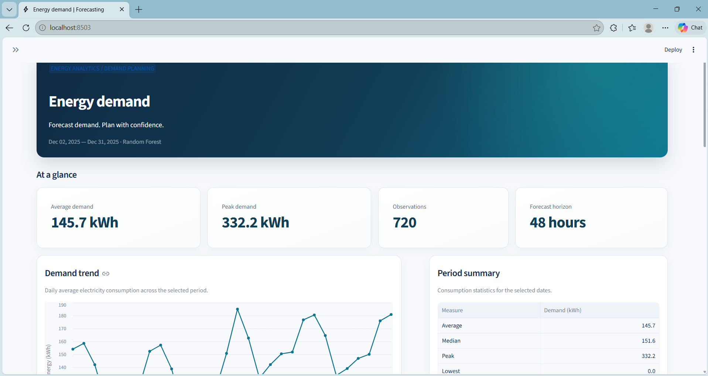</td>
    <td align="center"><strong>Demand overview</strong><br>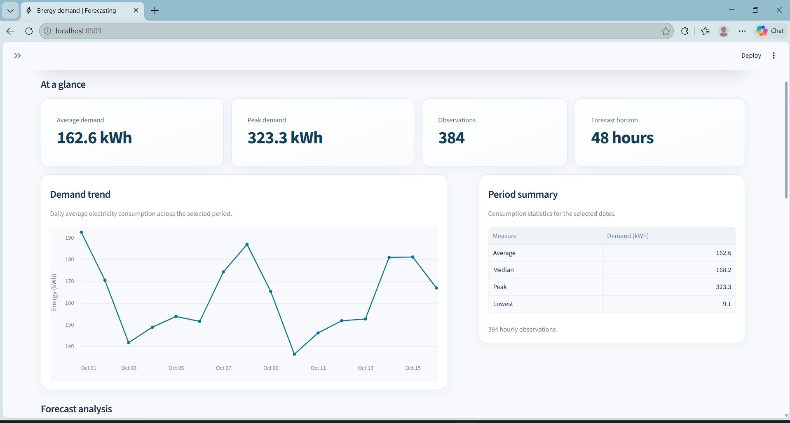</td>
  </tr>
  <tr>
    <td align="center"><strong>Period summary</strong><br>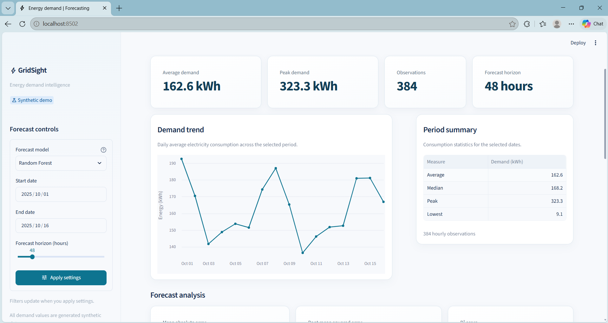</td>
    <td align="center"><strong>Forecast controls</strong><br>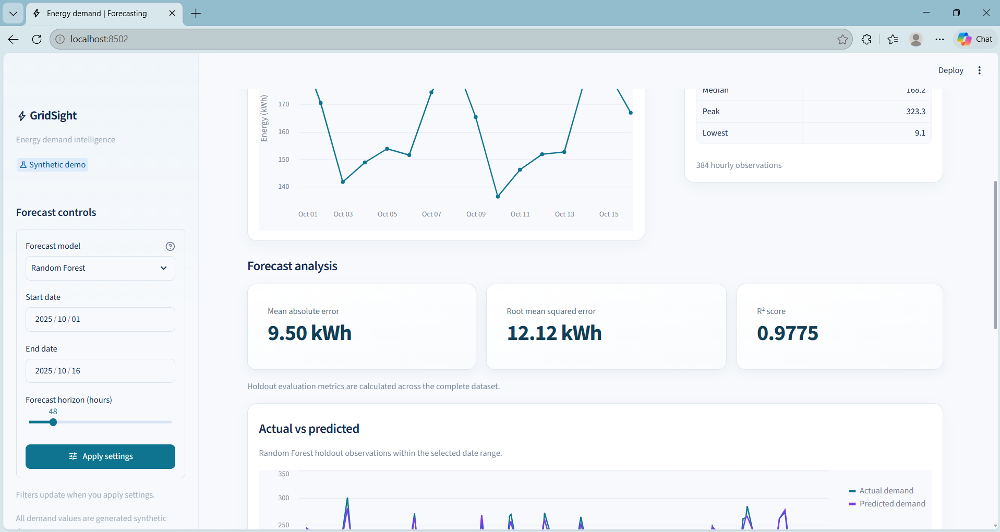</td>
  </tr>
</table>

### Random Forest evaluation

<table>
  <tr>
    <td align="center"><strong>Evaluation metrics</strong><br>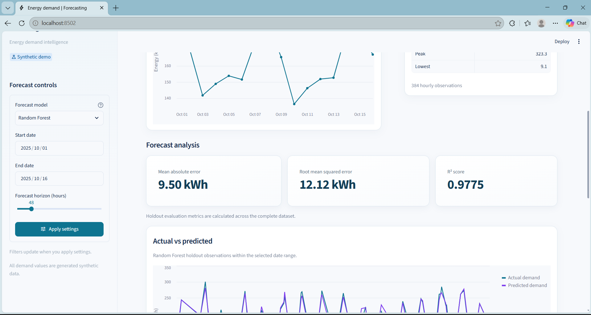</td>
    <td align="center"><strong>Actual vs. predicted</strong><br>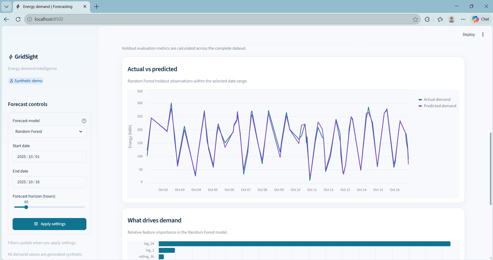</td>
  </tr>
  <tr>
    <td align="center"><strong>Feature importance</strong><br>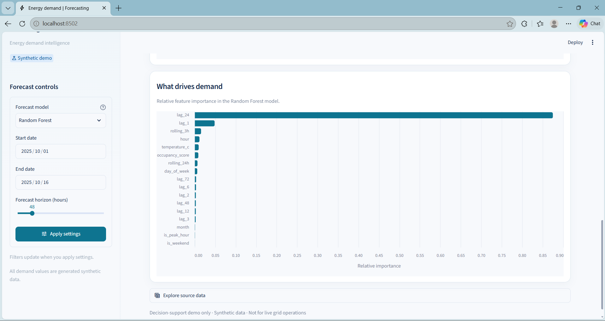</td>
    <td></td>
  </tr>
</table>

### SARIMA forecast and data exploration

<table>
  <tr>
    <td align="center"><strong>Forecast overview</strong><br>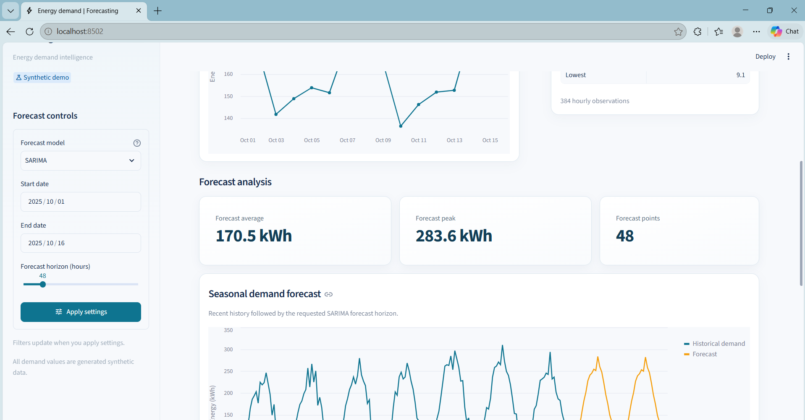</td>
    <td align="center"><strong>Seasonal demand forecast</strong><br>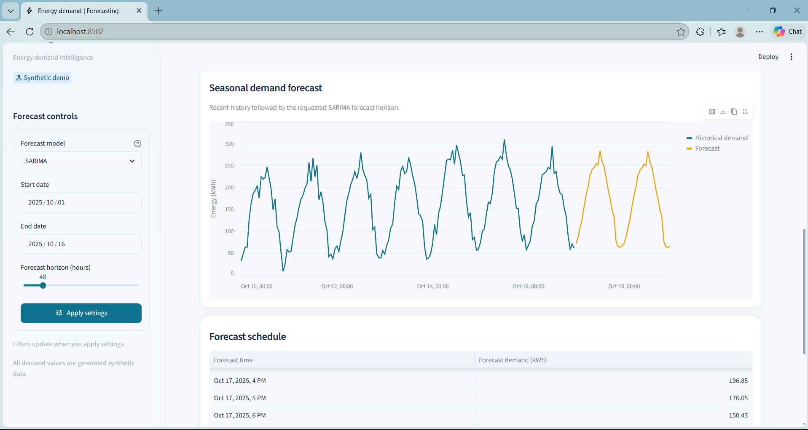</td>
  </tr>
  <tr>
    <td align="center"><strong>Forecast schedule</strong><br>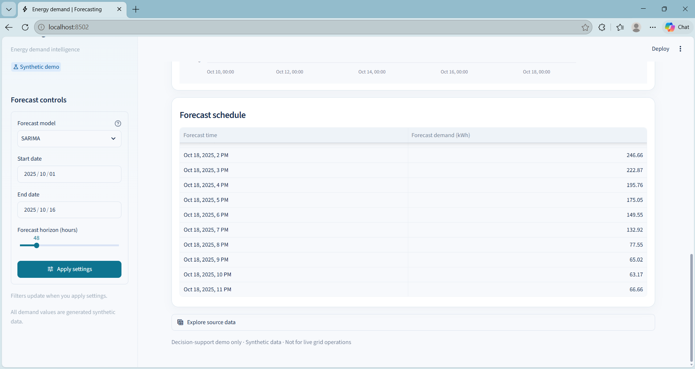</td>
    <td align="center"><strong>Source data</strong><br>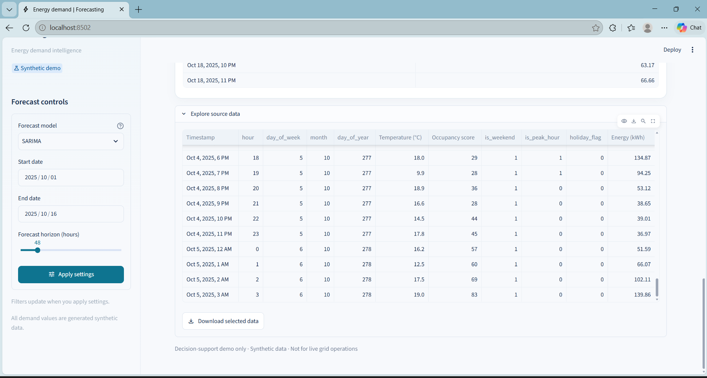</td>
  </tr>
</table>

### Tests, API, and architecture

<table>
  <tr>
    <td align="center"><strong>Automated tests</strong><br>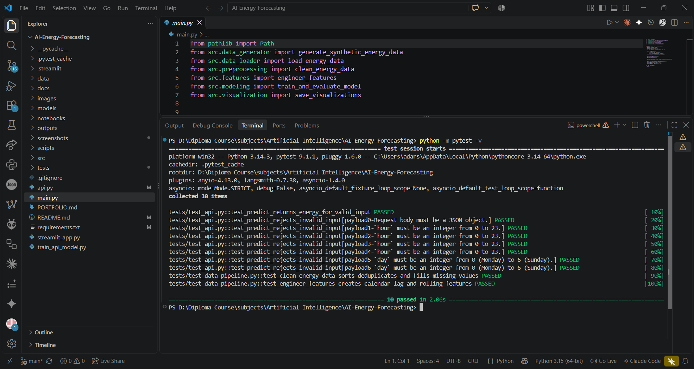</td>
    <td align="center"><strong>Prediction API</strong><br>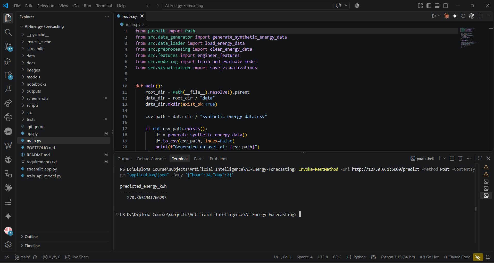</td>
  </tr>
  <tr>
    <td align="center"><strong>Project architecture</strong><br>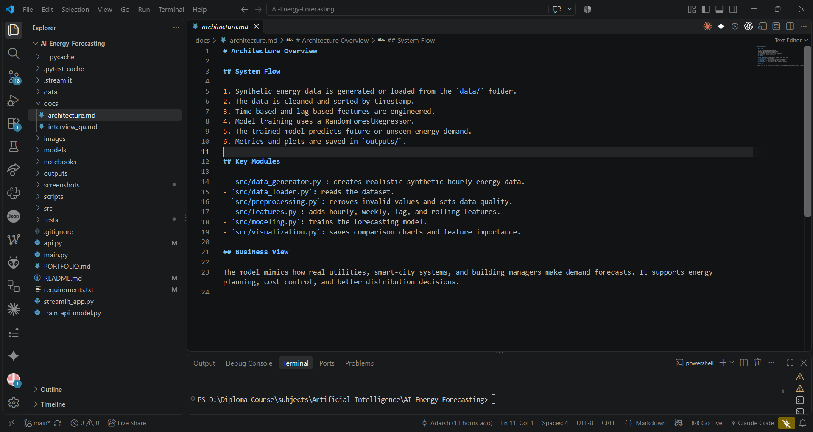</td>
    <td></td>
  </tr>
</table>

---

## 📁 Project Structure

```text
AI-Energy-Forecasting/
├── .streamlit/                 # Dashboard theme and styling
├── data/                       # Synthetic hourly energy dataset
├── docs/                       # Architecture and interview notes
├── images/                     # Dataset and analysis visuals
├── models/                     # Locally generated model artifacts
├── notebooks/                  # Forecasting and LSTM notebooks
├── outputs/                    # Generated evaluation visualizations
├── screenshots/                # README and portfolio screenshots
├── scripts/                    # Demo asset-generation utilities
├── src/                        # Data, feature, and model modules
├── tests/                      # Pytest suite
├── api.py                      # Flask prediction API
├── main.py                     # Training and evaluation workflow
├── streamlit_app.py            # Interactive forecasting dashboard
├── train_api_model.py          # Train the API's MLP model
└── requirements.txt             # Python dependencies
```

---

## 🧪 Testing

Run the automated tests from the repository root:

```bash
python -m pytest -v
```

The current suite contains **10 tests** covering successful API predictions, invalid API inputs, data cleaning, and feature engineering.

---

## ▶️ How to Run

### 1. Create and activate a virtual environment

Windows PowerShell:

```powershell
python -m venv .venv
.\.venv\Scripts\Activate.ps1
```

macOS/Linux:

```bash
python3 -m venv .venv
source .venv/bin/activate
```

### 2. Install dependencies

```bash
python -m pip install -r requirements.txt
```

### 3. Run the training workflow

```bash
python main.py
```

The workflow generates the synthetic CSV if it is missing, trains and evaluates the Random Forest model, saves its model artifact locally, and writes visualizations to `outputs/`.

### 4. Launch the dashboard

```bash
streamlit run streamlit_app.py
```

Open the local URL printed by Streamlit. Use the sidebar to choose the forecasting model, date range, and forecast horizon.

### 5. Run the Flask prediction API

Train the API model, then start the local API:

```bash
python train_api_model.py
python api.py
```

Send a sample request from Windows PowerShell:

```powershell
Invoke-RestMethod -Uri http://127.0.0.1:5000/predict -Method Post `
  -ContentType "application/json" -Body '{"hour":14,"day":2}'
```

The API accepts a JSON object with integer `hour` and `day` values and returns `predicted_energy_kwh`. It is a local demonstration service, not a production API.

---

## 📈 Example Results

One recorded Random Forest evaluation on the synthetic dataset:

```text
MAE:      9.50 kWh
RMSE:    12.12 kWh
R²:       0.9775
```

Results depend on the dataset and training environment. These example metrics are not a guarantee of accuracy on real-world energy data.

---

## 📓 Notebooks and Documentation

- [Forecasting demo notebook](notebooks/energy_forecasting_demo.ipynb)
- [LSTM forecasting notebook](notebooks/lstm_energy_forecasting.ipynb)
- [Architecture notes](docs/architecture.md)
- [Interview questions and answers](docs/interview_qa.md)
- [Portfolio summary](PORTFOLIO.md)

Generate supplementary dataset preview and analysis images with:

```bash
python scripts/generate_demo_assets.py
```

---

## 🌐 Applications

The concepts demonstrated here can inform:

- Building and campus demand planning
- Energy-consumption analysis
- Peak-demand awareness
- Smart-building prototypes
- Educational forecasting projects
- Renewable-energy planning experiments

These are potential applications of the techniques; the project itself operates on synthetic data.

---

## ⚠️ Limitations

- The provided energy dataset is synthetic, not a real utility dataset.
- Results may differ when data, dependencies, or model parameters change.
- The simple Flask API model uses only hour and weekday inputs.
- The API is intended for local demonstration and has not been production-hardened.
- The dashboard is a prototype and is not designed for live grid operations.
- The LSTM example is provided as a notebook, separate from the dashboard workflow.

---

## 🚀 Future Improvements

- Evaluate against a documented real-world energy dataset.
- Add weather-aware features and external data sources.
- Compare more forecasting models and validation strategies.
- Add forecast uncertainty intervals and richer error analysis.
- Improve API deployment, monitoring, and security for a production context.
- Deploy the dashboard to a suitable hosting platform.

---

## 🎓 Skills Demonstrated

### Data and machine learning

- Time-series data preparation
- Feature engineering
- Regression modeling
- Model evaluation with MAE, RMSE, and R²
- Seasonal forecasting

### Application development

- Interactive Streamlit dashboards
- Flask JSON API design and input validation
- Python project organization
- Automated testing with pytest

### Communication and tooling

- Data visualization
- Technical documentation
- Jupyter notebooks
- Git and GitHub workflow

---

## 🔬 Project Status

### ✅ Functional learning and portfolio demo

The repository includes a synthetic-data forecasting workflow, Random Forest and SARIMA paths, an interactive dashboard, a local Flask API example, notebooks, and automated tests.

> It is not validated for operational decisions using real grid data.

---

## ⭐ Conclusion

This project brings together data preparation, feature engineering, forecasting, evaluation, visualization, and lightweight application interfaces in one reproducible learning workflow. It illustrates how energy-demand analytics can be explored while clearly distinguishing synthetic demonstration results from real-world operational forecasting.

---

## ⭐ Project Highlights

```text
Hourly Synthetic Energy Data
Random Forest Evaluation
SARIMA Seasonal Forecasting
MAE / RMSE / R² Metrics
Interactive Streamlit Dashboard
Flask Prediction API
Pytest Automated Tests
Jupyter Forecasting Notebooks
Data Visualizations
GitHub Portfolio Screenshots
```
